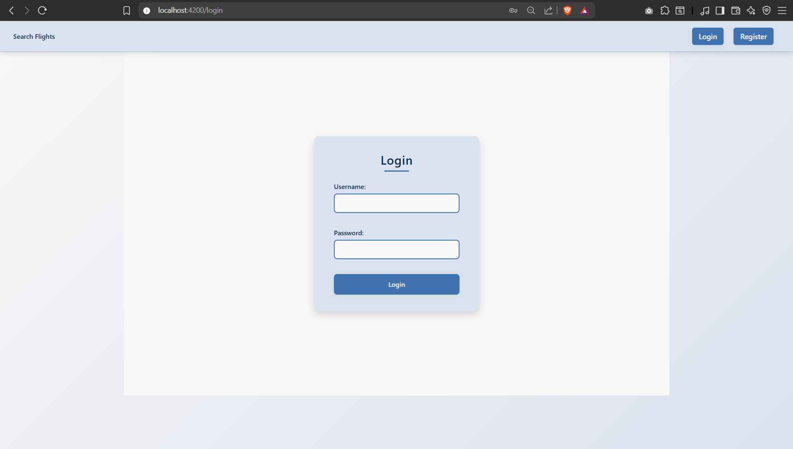
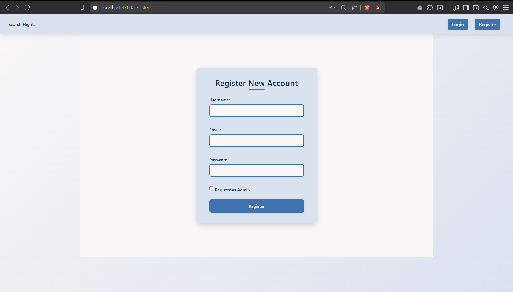
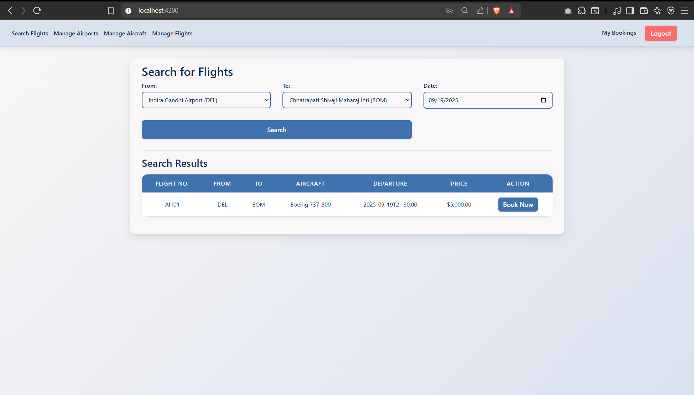
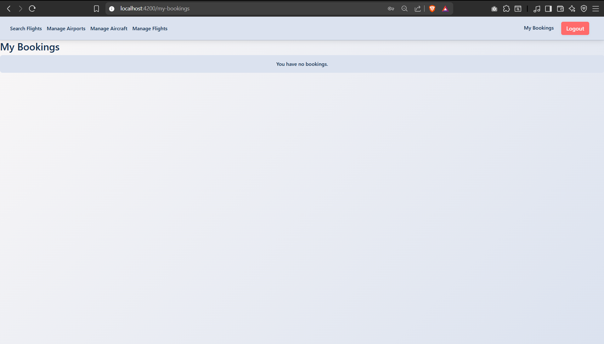
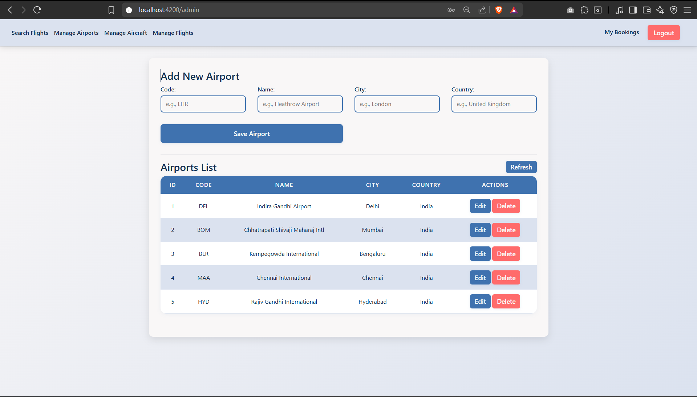
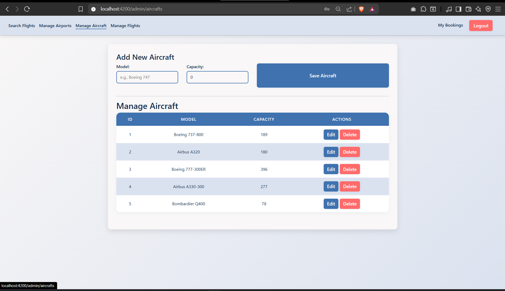
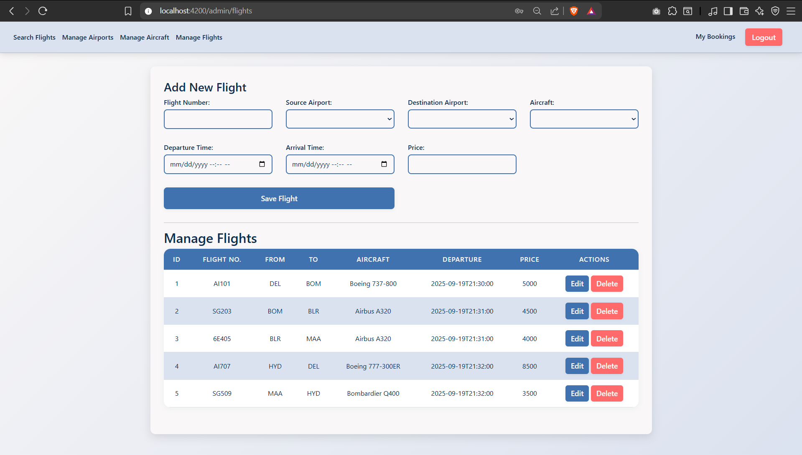

# SkyLink Booking Portal

A full-stack airline reservation web application with role-based access control, JWT authentication, and a clean Angular frontend backed by a Spring Boot REST API.

**Author:** Tanay Deo

---

## Overview

SkyLink is a two-role flight booking platform. Regular users can search for flights and manage their bookings, while administrators can manage the full inventory of airports, aircraft, and scheduled flights.

---

## Tech Stack

### Backend
| Layer | Technology |
|---|---|
| Framework | Spring Boot 3.5.5 |
| Language | Java 17 |
| Security | Spring Security + JWT (jjwt 0.11.5) |
| Persistence | Spring Data JPA / Hibernate |
| Database | MySQL |
| Utilities | Lombok |

### Frontend
| Layer | Technology |
|---|---|
| Framework | Angular 20 |
| Language | TypeScript 5.8 |
| Styling | Bootstrap 5.3 |
| Auth | jwt-decode 4 |

---

## Features

### User (public / authenticated)
- Register an account (as a regular user or admin)
- Log in and receive a JWT token
- Search flights by origin airport, destination airport, and date
- Book a flight (requires login)
- View and manage personal bookings (`/my-bookings`)

### Admin (protected routes under `/admin`)
- Manage airports — create, update, delete
- Manage aircraft — create, update, delete
- Schedule flights — assign aircraft, airports, departure/arrival times, and price

---

## Project Structure

```
SkyLink-Booking-Portal/
├── reservation_backend/          # Spring Boot API
│   └── src/main/java/com/airline/reservation/
│       ├── config/               # Security, CORS, JWT filter
│       ├── controller/           # REST endpoints
│       ├── dto/                  # Request/response DTOs
│       ├── model/                # JPA entities
│       ├── repository/           # Spring Data repositories
│       ├── service/              # Business logic
│       └── util/                 # JwtUtil
│
└── airline-frontend/             # Angular SPA
    └── src/app/
        ├── admin/                # Admin pages + services
        │   ├── manage-airports/
        │   ├── manage-aircraft/
        │   └── manage-flights/
        ├── user/                 # Public + user pages + services
        │   ├── login/
        │   ├── register/
        │   ├── flight-search/
        │   └── my-bookings/
        ├── guards/               # Auth guard
        └── interceptors/         # JWT interceptor
```

---

## API Endpoints

### Auth — `/api/auth`
| Method | Path | Description |
|---|---|---|
| POST | `/register` | Register a new user |
| POST | `/login` | Authenticate and receive JWT |

### Flights — `/api/flights`
| Method | Path | Auth | Description |
|---|---|---|---|
| GET | `/airports` | Public | List all airports |
| GET | `/search` | Public | Search flights by source, destination, date |
| GET | `/admin` | Admin | List all flights |
| POST | `/admin` | Admin | Create a new flight |
| PUT | `/admin/{id}` | Admin | Update a flight |
| DELETE | `/admin/{id}` | Admin | Delete a flight |

### Aircraft — `/api/aircrafts`
| Method | Path | Auth | Description |
|---|---|---|---|
| GET | `/admin` | Admin | List all aircraft |
| POST | `/admin` | Admin | Add aircraft |
| PUT | `/admin/{id}` | Admin | Update aircraft |
| DELETE | `/admin/{id}` | Admin | Delete aircraft |

### Airports — `/api/airports`
| Method | Path | Auth | Description |
|---|---|---|---|
| GET | `/admin` | Admin | List all airports |
| POST | `/admin` | Admin | Add airport |
| PUT | `/admin/{id}` | Admin | Update airport |
| DELETE | `/admin/{id}` | Admin | Delete airport |

### Bookings — `/api/bookings`
| Method | Path | Auth | Description |
|---|---|---|---|
| POST | `/` | User | Create a booking |
| GET | `/my` | User | Get current user's bookings |

---

## Getting Started

### Prerequisites
- Java 17+
- Node.js 18+ and npm
- MySQL 8+

### 1. Database Setup

Create the database and seed the required roles:

```sql
CREATE DATABASE airline_db;
USE airline_db;

INSERT INTO role (name) VALUES ('ROLE_USER');
INSERT INTO role (name) VALUES ('ROLE_ADMIN');
```

### 2. Backend

Update `reservation_backend/src/main/resources/application.properties` with your MySQL credentials:

```properties
spring.datasource.url=jdbc:mysql://localhost:3306/airline_db
spring.datasource.username=<your-username>
spring.datasource.password=<your-password>
```

> **Security note:** Replace `jwt.secret.key` with a strong secret before deploying to any non-local environment.

Then run:

```bash
cd reservation_backend
./mvnw spring-boot:run
```

The API will start at `http://localhost:8080`.

### 3. Frontend

```bash
cd airline-frontend/airline-frontend
npm install
ng serve
```

The app will be available at `http://localhost:4200`.

---

## Screenshots

| Login | Register |
|---|---|
|  |  |

| Search Flights | My Bookings |
|---|---|
|  |  |

| Manage Airports | Manage Aircraft | Schedule Flights |
|---|---|---|
|  |  |  |

---

## Data Model

```
User  ──── roles ────► Role
             │
             ▼
          Booking ────► Flight ────► Airport (source)
                                └──► Airport (destination)
                                └──► Aircraft
```

- **User** — username, email, hashed password, set of roles
- **Role** — `ROLE_USER` or `ROLE_ADMIN`
- **Airport** — name, IATA code, city, country
- **Aircraft** — model, registration, seat capacity
- **Flight** — flight number, source/destination airports, aircraft, departure/arrival times, price
- **Booking** — user, flight, status (`CONFIRMED` / `CANCELLED`)

---

## License

This project is for educational purposes.
